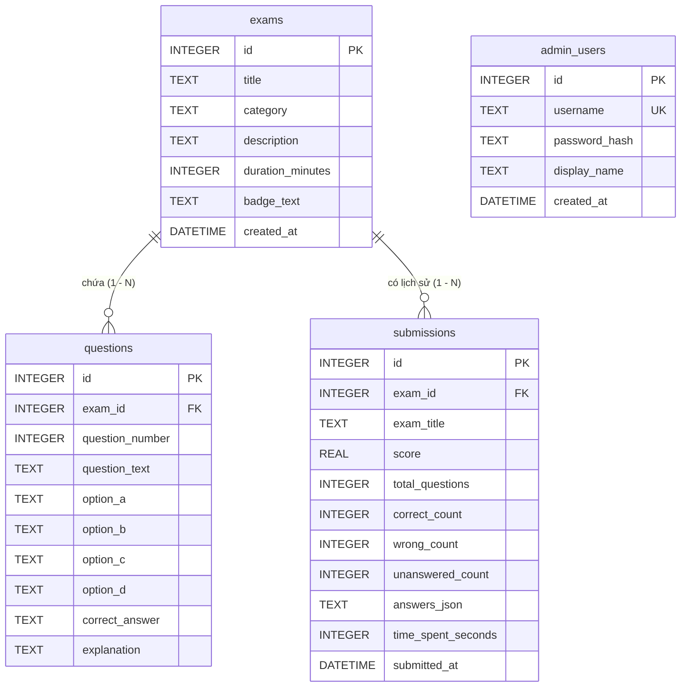
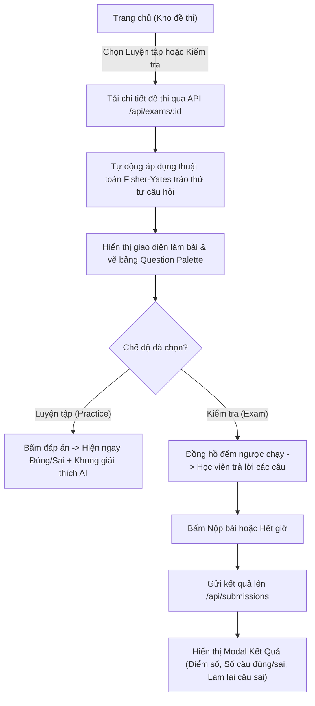

# UniPrep - Nền Tảng Luyện Thi & Trắc Nghiệm Trực Tuyến

> Hệ thống luyện thi trắc nghiệm trực tuyến hiện đại, chuẩn UI/UX, hỗ trợ 2 chế độ **Luyện tập** (giải thích AI tức thì) & **Kiểm tra** (bấm giờ chấm điểm), tự động tráo đề ngẫu nhiên, chế độ Sáng/Tối (Dark Mode), tích hợp SQLite Database và trang Dashboard Admin tải đề tự động từ file Word (.docx).

---

## 📑 Mục Lục
1. [🌟 Tính Năng Nổi Bật](#-tính-năng-nổi-bật)
2. [📁 Bản Đồ Cấu Trúc Mã Nguồn (Code Structure)](#-bản-đồ-cấu-trúc-mã-nguồn-code-structure)
3. [🧩 Chi Tiết Chức Năng Của Từng Tệp Tin](#-chi-tiết-chức-năng-của-từng-tệp-tin)
4. [🗄️ Cấu Trúc Cơ Sở Dữ Liệu (SQLite Schema)](#️-cấu-trúc-cơ-sở-dữ-liệu-sqlite-schema)
5. [🔄 Các Luồng Hoạt Động Chính (Lifecycle & Flows)](#-các-luồng-hoạt-động-chính-lifecycle--flows)
6. [🔐 Hướng Dẫn Đổi Tài Khoản & Mật Khẩu Quản Trị (Admin)](#-hướng-dẫn-đổi-tài-khoản--mật-khẩu-quản-trị-admin)
7. [🚀 Cài Đặt & Chạy Ứng Dụng](#-cài-đặt--chạy-ứng-dụng)
8. [☁️ Hướng Dẫn Triển Khai (Deploy lên Netlify)](#️-hướng-dẫn-triển-khai-deploy-lên-netlify)

---

## 🌟 Tính Năng Nổi Bật

- **Kho đề thi đa dạng & phân loại môn học**:
  - Hỗ trợ đầy đủ các môn đại cương: *Triết học Mác-Lênin*, *Kinh tế Chính trị*, *Toán Cao cấp*, *Vật lý Đại cương*, *Lịch sử Đảng*...
  - **Trọn bộ môn Quốc phòng An ninh**:
    - **Học phần 1**: Bài 1 đến Bài 8 + Đề thi Tổng hợp Full 211 câu.
    - **Học phần 2**: Bài 1 đến Bài 7 + Đề thi Tổng hợp Full 210 câu.
- **2 Chế độ thi chuyên nghiệp**:
  - 📖 **Chế độ Luyện tập (Practice Mode)**: Chọn đáp án hiển thị ngay đúng/sai, lời giải thích chi tiết và gợi ý mở rộng từ AI.
  - ⏱️ **Chế độ Kiểm tra (Exam Mode)**: Đồng hồ đếm ngược, bảng danh sách câu hỏi theo dõi trạng thái đã làm, nộp bài tính điểm thang 10, phân loại câu sai và làm lại câu sai.
- 🔀 **Tự động tráo câu hỏi (Fisher-Yates Shuffle)**: Mỗi lần bắt đầu làm đề hoặc bấm *"Tráo câu"*, hệ thống xáo trộn ngẫu nhiên thứ tự câu hỏi để chống học vẹt.
- 🌓 **Giao diện Sáng / Tối (Dark / Light Mode)**: Chuyển đổi linh hoạt 1-click, lưu cấu hình vào `localStorage`.
- 📄 **Trang Quản trị Admin thông minh**:
  - Đăng nhập bảo mật qua Token và SHA-256.
  - **Tải lên đề thi trực tiếp từ file Word (`.docx`)**: Tự động bóc tách câu hỏi, 4 đáp án A-B-C-D, đáp án đúng và lời giải bằng AI Text Parser.
  - Hỗ trợ dán văn bản thô, nhập form thủ công hoặc tải file JSON.
  - Sửa đề thi, xóa đề, xem lịch sử làm bài và thống kê điểm số học viên.
  - **Đổi tài khoản và mật khẩu Admin trực tiếp trên giao diện hoặc qua dòng lệnh CLI**.

---

## 📁 Bản Đồ Cấu Trúc Mã Nguồn (Code Structure)

```
d:\Project\Tracnghiemfree/
│
├── server.js                   # Node.js Express server & toàn bộ REST API
├── db.js                       # Quản lý SQLite database, tạo bảng & dữ liệu mẫu
├── parser.js                   # Bộ phân tích văn bản thông minh (Regex & AI Parser)
├── change_admin.js             # Công cụ CLI đổi tài khoản & mật khẩu Admin
│
├── data/
│   └── uniprep.db              # File cơ sở dữ liệu SQLite lưu trữ thực tế
│
├── public/                     # Frontend Single Page Application (SPA)
│   ├── index.html              # HTML duy nhất chứa toàn bộ màn hình (Home, Exam, Admin)
│   ├── favicon.svg             # Logo mũ tốt nghiệp UniPrep
│   ├── css/
│   │   └── style.css           # Tùy biến CSS, animation, scrollbar & Dark Mode
│   └── js/
│       ├── api.js              # Module gọi API (Fetch client, quản lý Bearer Token)
│       ├── app.js              # Router SPA, danh mục môn học, tìm kiếm & Theme Dark/Light
│       ├── exam.js             # Engine làm bài: đếm giờ, tráo đề, chọn đáp án, nộp bài & modal kết quả
│       └── admin.js            # Controller quản trị: đăng nhập, đổi mật khẩu, upload Word/Text, CRUD đề
│
├── netlify/
│   └── functions/
│       └── api.js              # Serverless wrapper để chạy Express trên Netlify Functions
├── netlify.toml                # File cấu hình định tuyến redirects & headers của Netlify
│
├── seed_qpan_lessons.js        # Script nạp dữ liệu QPAN Học phần 1 (Bài 1 - 8 + Full)
├── seed_qpan_hp2.js            # Script nạp dữ liệu QPAN Học phần 2 (Bài 1 - 7 + Full)
├── hp1_parsed_questions.json   # Dữ liệu JSON đã chuẩn hóa của HP1 (211 câu)
├── hp2_parsed_questions.json   # Dữ liệu JSON đã chuẩn hóa của HP2 (210 câu)
├── CAU_HOI_TRAC_NGHIEM_HP1...  # File Word gốc HP1
├── CAU_HOI_TRAC_NGHIEM_HP2...  # File Word gốc HP2
│
├── package.json                # Định nghĩa thư viện (Express, SQLite3, Mammoth, Multer...)
└── README.md                   # Tài liệu hướng dẫn sử dụng và giải thích kiến trúc
```

---

## 🧩 Chi Tiết Chức Năng Của Từng Tệp Tin

### 1. `server.js` (Backend REST API)
- Khởi chạy web server Express tại cổng `3000`.
- Thiết lập middleware: xử lý JSON body, phục vụ file tĩnh thư mục `public/`, upload file qua `multer`.
- **Cụm API Quản trị viên (Admin Auth & Account)**:
  - `POST /api/admin/login`: Xác thực đăng nhập bằng mã băm SHA-256, sinh phiên làm việc `Bearer Token` có thời hạn 24 giờ.
  - `GET /api/admin/me`: Kiểm tra phiên đăng nhập hiện tại từ Token.
  - `POST /api/admin/change-account`: Đổi tên đăng nhập, tên hiển thị và mật khẩu Quản trị viên (yêu cầu mật khẩu cũ để xác thực).
  - `POST /api/admin/logout`: Hủy bỏ phiên Token trong bộ nhớ máy chủ.
- **Cụm API Đề thi & Câu hỏi (Public & Admin)**:
  - `GET /api/categories`: Lấy danh sách môn học kèm số lượng đề thi tương ứng.
  - `GET /api/exams`: Lấy danh sách đề thi (hỗ trợ lọc theo danh mục hoặc từ khóa tìm kiếm).
  - `GET /api/exams/:id`: Lấy chi tiết đề thi và toàn bộ danh sách câu hỏi.
  - `POST /api/exams`: Đăng đề thi mới (Admin).
  - `PUT /api/exams/:id`: Cập nhật nội dung đề thi (Admin).
  - `DELETE /api/exams/:id`: Xóa đề thi (Admin).
- **Cụm API Phân tích Word & AI**:
  - `POST /api/admin/upload-word`: Nhận file `.docx`, dùng thư viện `mammoth` đọc văn bản thô và chuyển tiếp vào `parser.js` để tự động bóc tách câu hỏi.
  - `POST /api/ai/ask`: Cung cấp phân tích chi tiết, giải thích đơn giản hoặc đưa ra ví dụ thực tế cho câu hỏi.
- **Cụm API Làm bài & Thống kê**:
  - `POST /api/submissions`: Tiếp nhận bài thi nộp từ học viên, lưu điểm số, câu đúng, câu sai vào bảng `submissions`.
  - `GET /api/admin/stats`: Trả về số liệu tổng quan (Tổng số đề, Tổng số câu hỏi, Lượt làm bài, Điểm trung bình).

---

### 2. `db.js` (Cơ Sở Dữ Liệu SQLite)
- Khởi tạo kết nối đến file cơ sở dữ liệu `data/uniprep.db`.
- Cung cấp các hàm Promise helper bọc quanh SQLite3:
  - `run(sql, params)`: Thực thi câu lệnh `INSERT`, `UPDATE`, `DELETE`.
  - `get(sql, params)`: Lấy 1 bản ghi duy nhất.
  - `all(sql, params)`: Lấy danh sách nhiều bản ghi.
- Khởi tạo cấu trúc các bảng (`initDb`): `exams`, `questions`, `submissions`, `admin_users`.
- Tự động nạp tài khoản admin mặc định (`admin` / `admin123`) và các bộ đề mẫu ban đầu nếu cơ sở dữ liệu còn trống.

---

### 3. `parser.js` (Bộ Phân Tích Đề Thi Tự Động)
- Sử dụng các biểu thức chính quy (Regular Expressions) mạnh mẽ để nhận diện cấu trúc đề thi từ văn bản Word hoặc văn bản dán:
  - Nhận diện câu hỏi: `Câu 1:`, `Câu 1.`, `Câu 1 -`...
  - Nhận diện 4 phương án: `A.`, `B.`, `C.`, `D.` hoặc `A)`, `A,` (hỗ trợ cả các phương án nằm cùng dòng).
  - Nhận diện đáp án đúng: `Đáp án: A`, `Key: B`, `Đ/A: C`...
  - Nhận diện phần giải thích: `Giải thích: ...`, `Hướng dẫn giải: ...`.
- Tự động phát hiện tiêu đề bài thi ở những dòng đầu tiên của tài liệu.

---

### 4. `change_admin.js` (Công Cụ Quản Lý Tài Khoản Quản Trị Bằng Dòng Lệnh)
- Cho phép người quản trị đổi tài khoản và mật khẩu trực tiếp từ terminal mà không cần thông qua trình duyệt web.
- Hỗ trợ xử lý trường hợp quên mật khẩu quản trị.
- Tự động mã hóa mật khẩu mới sang chuẩn SHA-256 và cập nhật vào bảng `admin_users`.

---

### 5. `public/index.html` (Frontend Single Page Application)
Được cấu trúc theo mô hình **Single Page Application (SPA)**, không cần reload trang khi chuyển đổi:
- **Header chung**: Logo UniPrep, nút chuyển đổi danh mục, đồng hồ đếm giờ, nút nộp bài, nút Dark/Light Mode.
- **Section 1 - `#view-home`**: Màn hình trang chủ hiển thị bộ lọc danh mục thuốc (Pills), thanh tìm kiếm và lưới thẻ đề thi (Exam Cards).
- **Section 2 - `#view-exam`**: Màn hình làm bài thi gồm cột câu hỏi bên trái (chọn đáp án, xem giải thích AI) và bảng danh sách câu hỏi (Question Palette) bên phải.
- **Section 3 - `#view-admin`**: Bảng điều khiển quản trị gồm hàng thống kê chỉ số, tab tải đề (Word / Văn bản / Thủ công / JSON), bảng danh sách đề thi và lịch sử làm bài.
- **Hệ thống Modal popups**:
  - `#result-modal`: Modal tổng kết điểm thi, xem câu sai, nút làm lại câu sai.
  - `#admin-login-modal`: Modal đăng nhập Quản trị viên.
  - `#admin-account-modal`: Modal đổi tài khoản và mật khẩu Quản trị viên.

---

### 6. `public/js/app.js` (Điều Phối Giao Diện & Bộ Lọc)
- **Quản lý chuyển đổi View**: Hàm `App.showView('home' | 'exam' | 'admin')` kiểm soát việc ẩn/hiện các màn hình một cách mượt mà.
- **Xử lý danh mục & Tìm kiếm**: Tải danh sách môn học, lắng nghe sự kiện bấm chọn danh mục hoặc nhập ô tìm kiếm để lọc đề thi.
- **Quản lý Theme Sáng / Tối (Dark / Light)**: Đọc trạng thái từ `localStorage`, tự động gán class `dark` vào thẻ `<html>` và cập nhật biểu tượng mặt trời / mặt trăng.

---

### 7. `public/js/exam.js` (Engine Làm Bài & Chấm Điểm)
- **Quản lý trạng thái bài thi (`state`)**: Đề thi hiện tại, danh sách câu hỏi, câu hỏi đang chọn, câu trả lời của học viên, chế độ làm bài (`practice` hoặc `exam`).
- **Thuật toán tráo câu hỏi (`shuffleExam`)**: Ứng dụng thuật toán xáo trộn ngẫu nhiên Fisher-Yates để đảo thứ tự câu hỏi và đồng bộ lại bảng Question Palette.
- **Chế độ Luyện tập**: Bật cờ `AI giải thích ngay`, khi chọn đáp án sẽ kiểm tra ngay với đáp án chuẩn, đổi màu xanh/đỏ và hiển thị khung giải thích AI.
- **Chế độ Kiểm tra**: Khởi động đồng hồ đếm ngược `startTimer()`, khi hết giờ hoặc bấm "Nộp bài" sẽ chấm điểm tự động và bật `#result-modal`.
- **Làm lại câu sai**: Lọc riêng danh sách các câu làm sai để học viên luyện tập lại trọng tâm.

---

### 8. `public/js/admin.js` (Điều Khiển Trang Quản Trị)
- Quản lý phiên làm việc Admin: Kiểm tra đăng nhập qua `API.checkAdminAuth()`, hiển thị modal đăng nhập khi chưa có quyền.
- Quản lý kéo thả & upload file Word (`.docx`): Gửi file lên server, nhận câu hỏi đã phân tích và tự động điền vào form xem trước.
- Hỗ trợ chế độ Sửa đề thi (`editExam`): Tải lại toàn bộ câu hỏi của đề cũ vào form chỉnh sửa để lưu đè.
- **Modal đổi tài khoản & mật khẩu**: Thu thập dữ liệu từ `#admin-account-modal`, kiểm tra độ dài mật khẩu và gọi API cập nhật.

---

### 9. `public/js/api.js` (Client API)
- Đóng gói toàn bộ các hàm gọi API HTTP bằng `fetch`.
- Tự động đính kèm header `Authorization: Bearer <token>` nếu đã đăng nhập.
- Lưu trữ token vào `localStorage` (hoặc `sessionStorage`).

---

## 🗄️ Cấu Trúc Cơ Sở Dữ Liệu (SQLite Schema)

Cơ sở dữ liệu được lưu tại `data/uniprep.db` với 4 bảng:



---

## 🔄 Các Luồng Hoạt Động Chính (Lifecycle & Flows)

### 1. Luồng Người Dùng Vào Làm Bài Thi


---

## 🔐 Hướng Dẫn Đổi Tài Khoản & Mật Khẩu Quản Trị (Admin)

Hệ thống cung cấp **2 phương pháp tiện lợi** để thay đổi tài khoản và mật khẩu quản trị:

### Cách 1: Đổi trực tiếp trên giao diện Dashboard (Khuyên dùng)
1. Mở trình duyệt và truy cập `http://localhost:3000`.
2. Bấm vào nút **Quản trị & Up đề** ở góc trên bên phải thanh điều hướng.
3. Đăng nhập với tài khoản hiện tại:
   - Tên đăng nhập mặc định: `admin`
   - Mật khẩu mặc định: `admin123`
4. Trên thanh tiêu đề của trang Quản trị, bấm vào nút màu vàng **🔑 Đổi tài khoản**.
5. Trong cửa sổ hiện lên:
   - **Mật khẩu hiện tại**: Nhập mật khẩu bạn đang dùng để xác minh danh tính.
   - **Tên đăng nhập mới**: Nhập username bạn muốn (hoặc giữ nguyên nếu chỉ đổi mật khẩu).
   - **Tên hiển thị**: Nhập họ tên hoặc biệt danh hiển thị trên thanh quản trị.
   - **Mật khẩu mới**: Nhập mật khẩu mới (tối thiểu 4 ký tự).
   - **Xác nhận mật khẩu mới**: Nhập lại mật khẩu mới.
6. Bấm **Lưu Thay Đổi**. Hệ thống sẽ cập nhật ngay lập tức mà không cần khởi động lại server.

---

### Cách 2: Đổi nhanh bằng dòng lệnh CLI (Giải quyết khi quên mật khẩu)
Nếu bạn lỡ quên mật khẩu hoặc muốn đặt lại nhanh từ cửa sổ dòng lệnh Terminal / PowerShell:

1. Mở PowerShell hoặc Terminal tại thư mục dự án `d:\Project\Tracnghiemfree`.
2. Chạy lệnh theo cú pháp:
   ```bash
   node change_admin.js <tên_đăng_nhập_mới> <mật_khẩu_mới> "[tên_hiển_thị]"
   ```
3. **Ví dụ cụ thể**:
   - Đặt lại về tài khoản admin thông dụng:
     ```bash
     node change_admin.js admin 123456
     ```
   - Tạo tài khoản cá nhân có mật khẩu bảo mật cao:
     ```bash
     node change_admin.js ban-giam-hieu MatKhauKho@2026 "Ban Khảo Thí"
     ```
4. Màn hình sẽ thông báo cập nhật thành công và bạn có thể đăng nhập ngay với thông tin mới.

---

## 🚀 Cài Đặt & Chạy Ứng Dụng

### 1. Yêu Cầu Môi Trường
- Máy tính đã cài đặt **Node.js** (Khuyến nghị phiên bản v18, v20 hoặc mới hơn).

### 2. Các Bước Khởi Chạy
1. Mở terminal tại thư mục dự án:
   ```bash
   cd d:\Project\Tracnghiemfree
   ```
2. Khởi động ứng dụng:
   ```bash
   npm start
   ```
   *(Hoặc chạy lệnh: `node server.js`)*
3. Mở trình duyệt web và truy cập địa chỉ:
   ```text
   http://localhost:3000
   ```

---

## ☁️ Hướng Dẫn Triển Khai (Deploy lên Netlify)

Dự án đã được cấu hình sẵn tệp [netlify.toml](file:///d:/Project/Tracnghiemfree/netlify.toml) và thư mục [netlify/functions/api.js](file:///d:/Project/Tracnghiemfree/netlify/functions/api.js):

1. **Cấu hình Netlify**:
   - **Build command**: `npm install`
   - **Publish directory**: `public`
   - **Functions directory**: `netlify/functions`
2. **Quy tắc điều hướng (Redirects)**:
   - Các yêu cầu đến `/api/*` sẽ được tự động chuyển hướng đến serverless function `/.netlify/functions/api/:splat`.
   - Các yêu cầu trang web còn lại sẽ trả về giao diện Single Page App tại `index.html`.
3. Đẩy mã nguồn lên kho chứa GitHub / GitLab và kết nối với Netlify để hoàn tất quá trình xuất bản tự động (CI/CD).